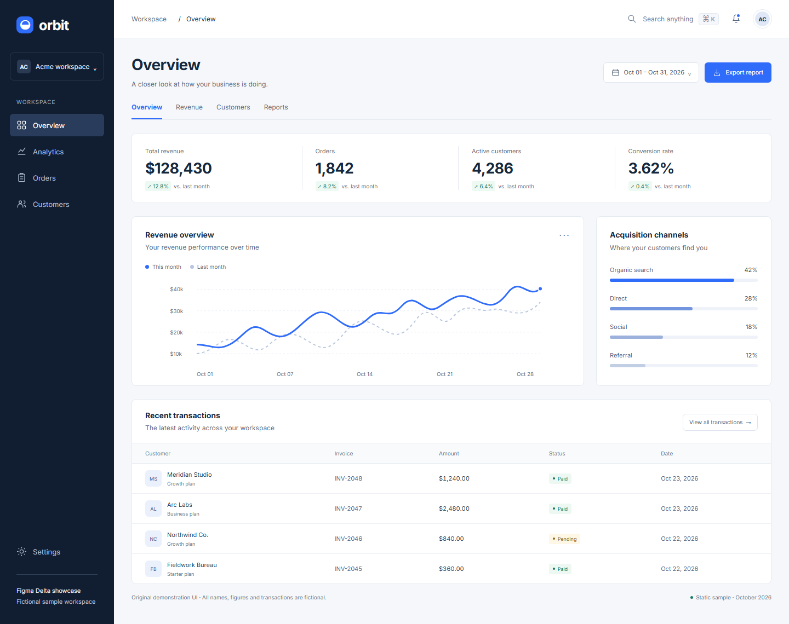
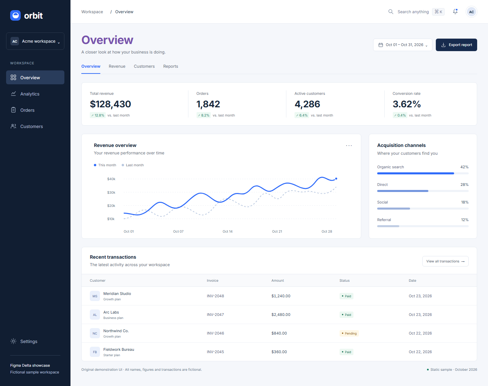

# Dashboard showcase

These images are captured from an original, static dashboard fixture and a real Figma Delta report. All workspace names, customers, transactions and figures are fictional. The fixture uses a local PNG reference; it does not depend on a live Figma file or claim autonomous AI repair.

## Sample reference

The reference dashboard includes a navigation sidebar, business metrics, revenue chart, acquisition channels and transaction table.



## Implementation with intentional differences

Five deliberate CSS changes give QA and developers concrete findings to inspect:

| Element | Property | Reference | Implementation |
| --- | --- | --- | --- |
| Page title | Text color | `#18283c` | `#7752ad` |
| Page title | Font size | `28px` | `34px` |
| Export button | Background color | `#306cfa` | `#172b4d` |
| Metric strip | Column gap | `24px` | `40px` |
| Revenue panel | Left padding | `24px` | `36px` |

The report converts both color representations to the same extended sRGB format before comparing them.



## Actual QA workspace

The screenshot shows the generated report with its findings list, expected-versus-actual property values, affected-area evidence, review controls and developer handoff actions. The selected title finding also shows the font-size difference for that same mapped element. These are unreviewed findings; a reviewer decides severity and whether a difference is a defect.


## Reproduce from source

From a source checkout with Node.js 24 (minimum 24.22.1):

```bash
npm ci
npm run setup
npm run showcase
```

This renders both dashboard variants in Chromium, calls the prepared-page API, verifies all five property findings, and saves these three screenshots under `docs/images/`. It then applies the known fixture correction and verifies a passing comparison against the same pinned reference. The generated interactive report stays under ignored `.demo-project/showcase/`; its path is printed by the command.

The dashboard is a static visual fixture. Export, search and navigation controls are illustrative; it is not a functional analytics product. Screenshot rendering can vary with browser version and platform font rasterization. Use the generator's measured pass/fail assertions rather than treating a committed screenshot as a cross-platform pixel baseline.

The fixture and charts are original repository content under the MIT license. Inter is loaded locally from the existing `@fontsource/inter` dependency, under its included SIL Open Font License. No private customer data, third-party dashboard screenshots or externally downloaded design assets are included.

For your own application, choose a [sample prompt](sample-prompts.md) and supply its actual Figma frame or PNG reference and known mappings.
