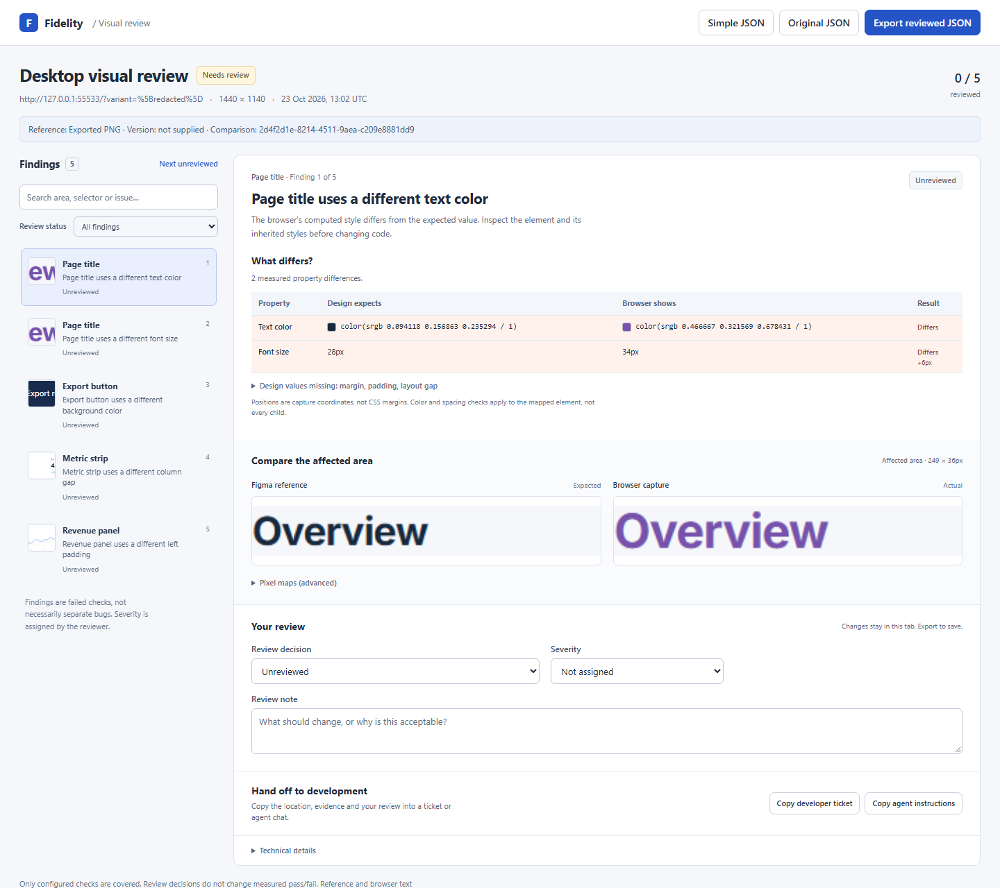
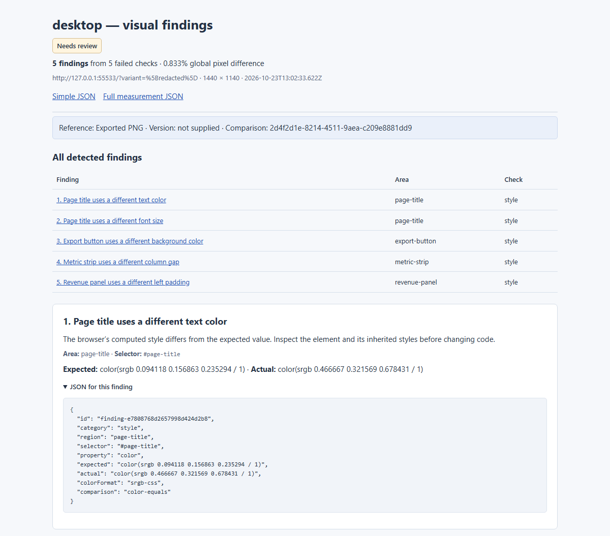
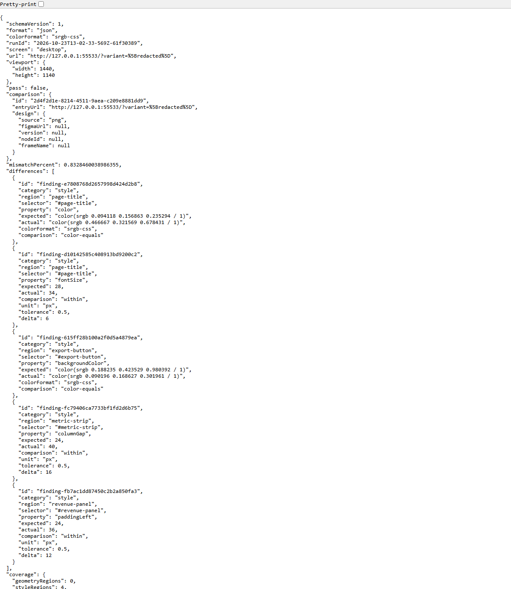
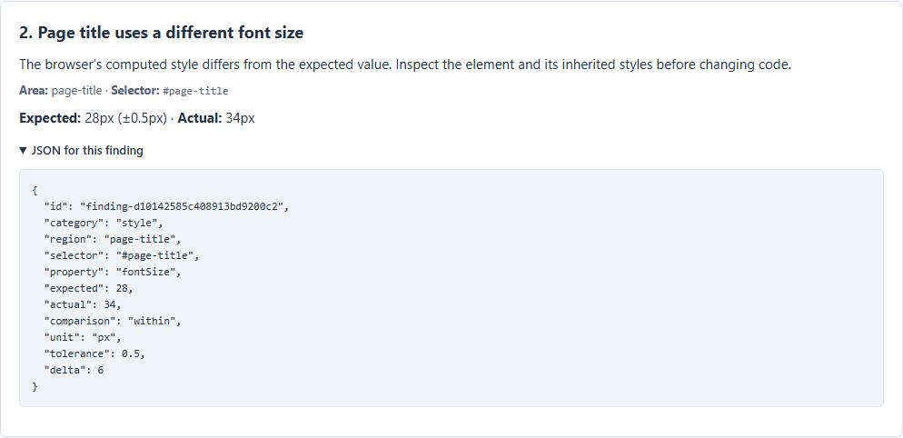

# Report showcase

These screenshots show **Figma Delta's generated reports**: the QA workspace, the default simple HTML report, compact JSON output and the JSON for an individual finding. They use real measured results from a fictional fixture with five deliberate CSS differences. No report values are invented.

## Interactive QA report

Review all findings in the sidebar, select an affected element, and compare its expected and actual properties alongside the captured evidence. The selected title finding shows a text-color difference and a font-size difference: `28px` expected, `34px` measured. Colors are normalized to the same extended sRGB format before comparison.

The workspace also provides review decisions, severity, notes and developer/agent handoffs. These screenshots leave findings unreviewed; a person decides whether a difference is a defect and assigns its severity.



## Simple HTML report

The default report lists all findings and puts the relevant JSON next to each one. It avoids embedding screenshots or a large interactive application, making it useful for quick QA triage and agent handoff. Screenshot evidence remains available through links.



## Compact JSON output

This is the saved `result.json`, displayed in the browser with whitespace formatting for readability. It includes comparison context and failed property checks with selectors, normalized expected/actual values, comparison methods and deltas where available. The image shows the beginning of the file; the complete JSON also contains coverage and artifact paths.



## JSON for one finding

This close-up comes directly from the generated simple report. The title's font size is `28px` in the reference and `34px` in the browser, a `6px` difference. The JSON includes the selector, pixel unit, comparison method and tolerance, ready for a developer or agent to inspect.



## Reproduce from source

From a source checkout with Node.js 24 (minimum 24.22.1):

```bash
npm ci
npm run setup
npm run showcase
```

The command renders an original static fixture, captures its local PNG reference, and introduces five known CSS changes: title color, title font size, button background, column gap and left padding. It calls the real prepared-page API to generate the reports, verifies all five property findings, and saves the four report screenshots under `docs/images/`. Finally, it applies the known fixture correction and verifies a pass against the same pinned reference.

Report HTML, JSON and screenshot evidence stay under ignored `.demo-project/showcase/`; paths are printed by the command. These are original fixture results, not a live Figma import or an autonomous AI repair claim. All fixture data is fictional. The source fixture and charts are original MIT-licensed repository content; Inter comes from the existing `@fontsource/inter` dependency under its included SIL Open Font License.

Browser and font rendering may vary by platform. Committed images illustrate the product; the generator's measured assertions verify the fixture. A passing report covers configured checks, not functional behavior or accessibility.

For your own application, start with a [sample prompt](sample-prompts.md) and supply its actual Figma frame or PNG reference and known mappings.
